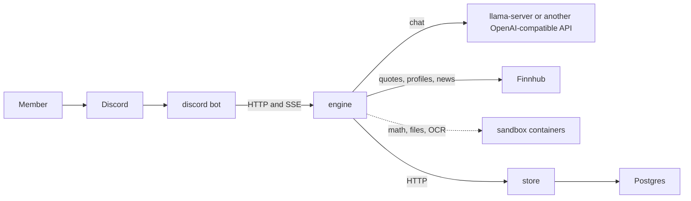

<p align="center">
  
</p>

<h3 align="center">Bullpen</h3>

<p align="center">
  <a href="docs/ARCHITECTURE.md">Architecture</a> |
  <a href="docs/ROADMAP.md">Roadmap</a> |
  <a href="deploy/README.md">Setup</a>
</p>

Bullpen is a stock market assistant for Discord: a Rust agent engine, a Discord bot, a developer console, and evals. Ask it for a price, a company's profile and valuation figures, today's market news, whether the market is open, or what a position is worth, and it answers from live market data with the time and the source. It gives information, not investment advice.

## Architecture

The engine runs its own agent loop and calls its tools itself. Market data comes from the [Finnhub](https://finnhub.io) REST API behind a `MarketData` trait, so another provider is one more implementation. Arithmetic on prices and positions, and any file a user attaches, run in an isolated sandbox container; scanned documents are read there by [PaddleOCR](https://github.com/PaddlePaddle/PaddleOCR), Baidu's open-source OCR, with tesseract as the fallback. Conversations, memories, the profile graph and confirmations live in the store service (`apps/store`) on Postgres, which the engine reaches over HTTP. The engine opens no database.



[docs/ARCHITECTURE.md](docs/ARCHITECTURE.md) has the details.

## Tools the agent calls

| Tool | Answers |
|---|---|
| `market_quote` | latest price, move on the day, session range, time of last trade |
| `market_search` | the ticker of a company or fund from its name |
| `market_profile` | exchange, industry, market cap, IPO, website, P/E, EPS, 52-week range, dividend yield, beta |
| `market_news` | recent headlines with links, for one symbol or the whole market |
| `market_status` | whether an exchange is open, its session, and any holiday |
| `run_sandbox` | returns, gains and comparisons computed in Python; attached files; OCR of scans |
| `wikipedia_lookup` | background on a company, an index, or a term |

## Run it

### 1. Get the accounts and keys

| You need | Where to get it | Goes in `.env` as |
|---|---|---|
| A Discord bot token | [Discord Developer Portal](https://discord.com/developers/applications): New Application, then Bot, then Reset Token | `BULLPEN_DISCORD__TOKEN` |
| Your Discord server id | Discord settings, Advanced, turn on Developer Mode; then right-click the server and Copy Server ID | `BULLPEN_DISCORD__GUILD_ID` |
| A market data key | [finnhub.io/register](https://finnhub.io/register), free tier | `BULLPEN_MARKET__API_KEY` |
| A store token and a Postgres password | any secret of 16 characters or more, shared by the engine and the store; any password for the local Postgres | `BULLPEN_STORE__TOKEN`, `BULLPEN_POSTGRES_PASSWORD`, and the same password in `BULLPEN_STORE__DATABASE_URL` |
| A chat model | `just model` (NVIDIA GPU), `just model-cpu`, or any OpenAI-compatible API | `BULLPEN_MODEL__BASE_URL`, `BULLPEN_MODEL__API_KEY` |

In the Developer Portal, on the Bot page, turn on **Message Content Intent**; without it the bot sees mentions but not what they say. Then open OAuth2, URL Generator, tick `bot` and `applications.commands`, give it Send Messages, Create Public Threads, Send Messages in Threads, Read Message History and Attach Files, and open the link to add the bot to your server.

### 2. Install and start

Needs [just](https://just.systems), Rust, [uv](https://docs.astral.sh/uv), Node, and Docker. `just doctor` names anything missing.

```bash
just bootstrap        # creates .env from .env.example, installs the git hook and dependencies
# fill in .env with the values from the table above
just sandbox-images   # builds the sandbox image (Python, PaddleOCR, tesseract); needs Docker running
just model            # llama-server chat on CUDA; just model-cpu without a GPU, or skip for a hosted API
just postgres         # Postgres on localhost:5432 for the store
just store            # in one shell; applies its migrations and listens on :8090
just engine           # in another
just discord          # in a third
```

`just cli` opens a terminal console that starts, stops, and tails every piece instead of separate shells. `just up` runs Postgres, the store, the engine, the bot, and the sandbox runtime together in Docker Compose; [deploy/README.md](deploy/README.md) covers production.

The engine logs `listening` once it is ready, and the bot logs `connected` and `commands registered`. `curl localhost:8080/health/ready` answers `{"store":true,"model":true}` when everything it needs is reachable.

Any OpenAI-compatible model endpoint works in place of llama-server, Baidu's ERNIE models on Qianfan included: set `BULLPEN_MODEL__BASE_URL`, `BULLPEN_MODEL__API_KEY`, and `name` under `[model]` in `bullpen.toml`.

## Use it

### Ask a question

- **In a channel**, mention the bot: `@Bullpen how is NVDA doing today?` It opens a thread named after the question and answers there.
- **In that thread**, use Discord's Reply on one of Bullpen's messages to keep going; a plain message in the thread is not answered. It remembers the conversation: `and how does that compare to AMD?`
- **In a direct message**, just write. Only direct messages use what Bullpen remembers about you, such as the stocks you said you hold.

While it works, the reply shows each step it takes (checking the price, reading the news). The finished answer gives the figures with their time, and buttons under it link to the stories and pages it used.

### What to ask

| Ask | Example |
|---|---|
| A price | `what's AAPL at?` or `price of $TSLA` |
| A company by name | `what's the ticker for Palantir?` |
| A comparison | `compare Apple and Microsoft today` |
| Valuation figures | `what's Microsoft's P/E and market cap?` |
| Why something moved | `why is Nvidia down today?` |
| Market news | `what's moving the market?` |
| Market hours | `is the market open?` |
| Position math | `I bought 40 AAPL at 112.50, what am I up?` |
| Background | `what is an ETF?` |

Bullpen gives information, not advice. Asked whether to buy or sell, it lays out the price, range, figures, and news, and leaves the decision to you. It does not predict prices.

### Attach a file

Drop a file into your message, up to 4 files of 2 MB each. It reads CSV and Excel (a list of holdings, for example), Word, PDF, and text. A scanned PDF or a photo of a statement is read with PaddleOCR. `attached is my portfolio, what's it worth today?` reads the file, quotes each symbol, and adds it up.

For Chinese documents, set `upload_ocr_lang = "ch"` under `[agent]` in `bullpen.toml`.

### Slash commands

| Command | Does |
|---|---|
| `/reset` | ends the conversation in this channel; the next question starts fresh |
| `/memory` | lists what Bullpen remembers about you |
| `/forget` | forgets one thing from `/memory`, or everything when left empty |

When a tool would change something outside Bullpen, such as a write tool from an MCP server, only members with the Manage Server permission can ask for it. The reply then shows Approve and Deny buttons, and nothing runs until the person who asked presses Approve. An approval expires after 10 minutes.

### Change how it behaves

Everything tunable is in `bullpen.toml`; restart the engine or bot after editing it.

| To | Set |
|---|---|
| Answer only in some channels | `channels = ["123..."]` under `[bot]` |
| Turn off direct messages | `direct_messages = false` under `[bot]` |
| Remove a tool | `disabled = ["market_news"]` under `[tools]` |
| Show more news stories or look further back | `max_items` and `news_days` under `[market]` |
| Use another exchange for market hours | `default_exchange = "L"` under `[market]` |
| Change its instructions | `system_file = "prompts/bullpen.md"` under `[prompt]` |

### When something goes wrong

| You see | Fix |
|---|---|
| The engine exits at start naming `MARKET__API_KEY` | put your Finnhub key in `.env`, or set `BULLPEN_MARKET__ENABLED=false` |
| The bot is online but ignores mentions | turn on Message Content Intent in the Developer Portal, and check `channels` under `[bot]` |
| The bot ignores a message in its thread | use Discord's Reply on one of its messages |
| `the model is unavailable` | start `just model`, or check `BULLPEN_MODEL__BASE_URL` |
| `market data rate limit reached` | the free Finnhub tier allows about 60 calls a minute; wait, or upgrade the key |
| Scans come back empty | build the sandbox image with `just sandbox-images` on an amd64 machine for PaddleOCR; elsewhere tesseract reads them |

## What is in the repo

| Path | Holds |
| --- | --- |
| `apps/engine/` | Rust: the agent loop, market tools, policy, memory, tracing, and the HTTP API |
| `apps/discord/` | Rust: the Discord bot, an HTTP client of the engine |
| `apps/cli/` | Rust: a terminal console that runs and tails every unit |
| `apps/evals/` | Python: golden cases, scorers, and the baseline gate |
| `apps/web/` | Vite and React: the landing site |
| `deploy/` | Compose files, Dockerfiles, and model server config |
| `docs/` | `ARCHITECTURE.md` and `ROADMAP.md` |

## Evals

Evals send golden cases from `apps/evals/cases/` to a running engine and score its traces: which market tool ran with which symbol, whether the answer cites its source, whether it declines to give advice or predictions, and whether it ever names its own tools.

```bash
just eval run                  # every suite
just eval run --suite voice    # one suite
just eval baseline             # promote the last report to the baseline
just eval compare              # compare the last report with the baseline
```

No baseline is committed yet; the first `just eval baseline` against a live engine sets it.

## Not investment advice

Bullpen reports market data and news; it does not tell anyone to buy, sell, or hold, and it does not predict prices. Data may be delayed and comes from third-party providers under their terms.

## Docs

- [docs/ARCHITECTURE.md](docs/ARCHITECTURE.md): crate boundaries, traits, the market data tools, and invariants
- [docs/ROADMAP.md](docs/ROADMAP.md): what is built next, and what is out of scope
- [AGENTS.md](AGENTS.md): commands and rules for contributors and coding agents

## License

[MIT](LICENSE).
