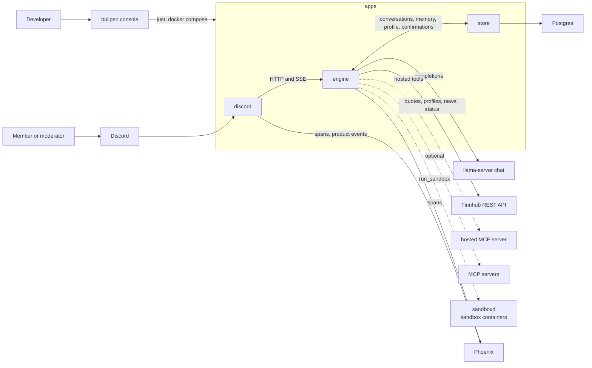
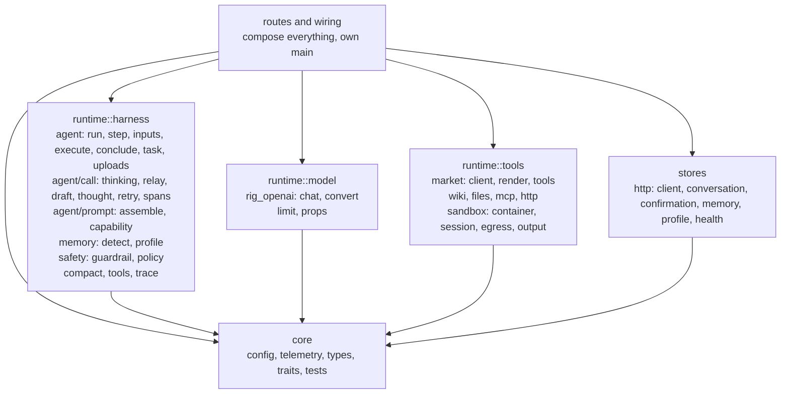
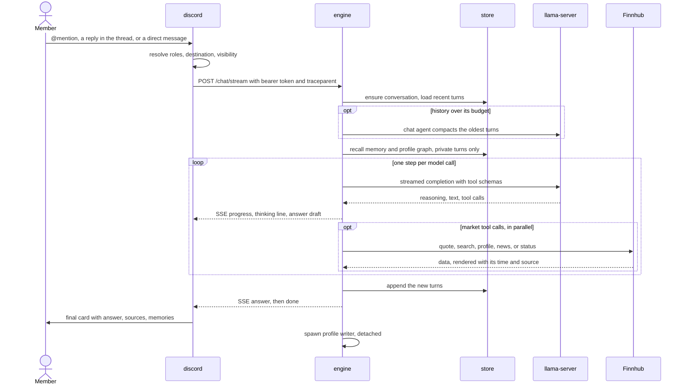
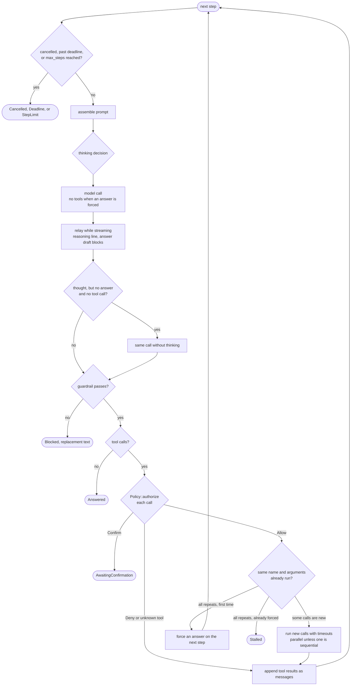
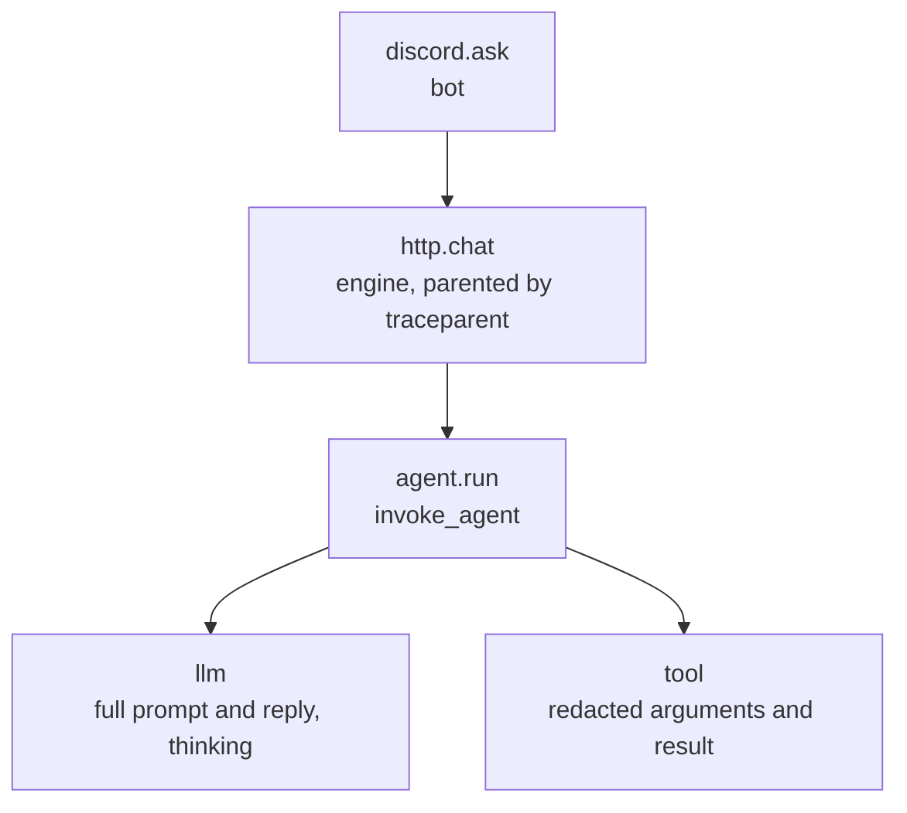
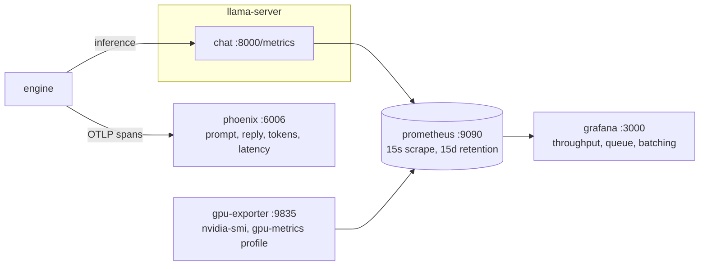

# Architecture

Bullpen is a stock market assistant for Discord. It answers questions about prices, companies, and market news from live market data, keeps conversation history and a profile of each user, and gates moderator actions behind policy and confirmation. It gives information, not investment advice.

This document describes the current shape of the system and its rules. Order of work is in [ROADMAP.md](ROADMAP.md). Decisions are recorded in the commits that settle them.

## Stack

| Layer | Choice | Where |
|---|---|---|
| Engine, store, Discord bot, console | tokio, axum, serenity, ratatui, serde, thiserror, figment | `apps/engine`, `apps/store`, `apps/discord`, `apps/cli` |
| Model client | Rig (`rig-core`) OpenAI-compatible client | `apps/engine/src/runtime/model/rig_openai/` |
| MCP | `rmcp` | `apps/engine/src/runtime/tools/mcp.rs` |
| Market data | Finnhub REST API behind the `MarketData` trait | `apps/engine/src/runtime/tools/market/` |
| Stores | the store service over HTTP, on Postgres through sqlx | `apps/store` |
| Web | Vite, React, TypeScript, shadcn | `apps/web` |
| Evals | golden cases against the engine, baseline gate | `apps/evals` |
| Chat model | Qwen3 GGUF on `llama-server` | compose service `chat`, profile `model` |
| OCR | PaddleOCR (Baidu, open source) in the sandbox image, tesseract as the fallback | `deploy/docker/sandbox.Dockerfile` |
| Observability | OpenTelemetry spans to Phoenix, product events as spans, JSONL traces and logs under `.bullpen/` | profiles `phoenix`, `metrics` |
| Config | `bullpen.toml`, then `BULLPEN_*` env vars | `bullpen.toml`, `.env.example` |
| Build, gate | `just` recipes, pre-commit hook, CI | `justfile`, `.githooks`, `.github/workflows` |
| Deploy | Docker Compose, prod pulls GHCR images; one RunPod GPU pod under supervisord, without run_sandbox | `deploy/` |

## Rules

- Open models only, served by `llama-server` behind an OpenAI-compatible HTTP API.
- Prices, figures, and headlines come from a market tool result in the same turn, never from model weights.
- Bullpen gives information, not investment advice: no buy, sell, or hold calls and no price predictions.
- The engine opens no database connection. Every store is the store service HTTP API; only `apps/store` opens Postgres.
- Every request carries its own `RequestContext`. There is no global mutable state.
- Every replaceable dependency is a trait in `engine/src/core/traits` with a test double in `core/tests/support`.
- The harness owns the loop, policy, context assembly, memory, and tracing. Provider JSON never leaves `runtime/model`.
- Model output is never stored or cited as if it were market data.
- An action at or above `policy.confirm_from` is held for the caller's approval immediately before it runs.
- Credentials, cookies, and API keys never enter a prompt, memory, or a trace. The market data key travels in a request header, never in a URL.

## Layout

```
apps/
  engine/         Rust bin. The agent, its HTTP surface, and the store adapters.
    src/core/       config (services, integrations, http, harness by domain), telemetry, types, traits, tests
    src/runtime/    harness (loop, prompt, uploads, memory, safety, compaction, trace), model (Rig client, slot limit, server props), tools (market: quote, search, profile, news, status over the Finnhub client; wiki, files, mcp, sandbox, shared http)
    src/stores/     http/: client, conversation, confirmation, memory, profile, health over the store HTTP API
    src/routes/     chat (JSON and SSE), confirm, conversation, profile, sandbox, health, rate limit, auth, failure
    src/wiring/     builds every dependency from config and serves: stores, tools, agent, http, boot checks, system prompt
  store/          Rust bin. Conversations, memories, the profile graph and confirmations over HTTP on Postgres.
    src/core/       config, telemetry, types, tests
    src/db/         the pool, migrations, and one file of queries per store
    src/routes/     health, the bearer check, and one file of handlers per store
    migrations/     sqlx migrations, applied at boot
  discord/        Rust bin. serenity bot and HTTP client of the engine. Never links it.
    src/core/       config, telemetry, types, tests
    src/bot/        client, addressed messages, turn destinations, memory commands, approvals, replies, the streamed turn
    src/engine/     HTTP client of the engine and SSE frame parsing
    src/render/     the turn card, reply text, buttons and their custom ids
    src/access/     roles, permissions, where a turn is answered, and what a message carries
    src/analytics/  product events, one exported span each
  cli/            Rust bin bullpen. Developer console: runs just recipes and compose services and tails them.
    src/core/       config, types, tests
    src/app/        console state, key map, control, rendering
    src/units/      unit catalog, process runner, output parsing, log buffers, health probes, engine sandbox
  evals/          Python. Evals with a baseline gate.
    core/           settings, types, tests
    cli.py          eval run, baseline, compare
    runner.py       loads cases and runs them against the engine /chat
    suites/         one scorer per suite, SUITES in __init__.py
    cases/          golden cases, one JSON object per line
  web/            Vite and React frontend and admin UI
deploy/           compose (dev and prod), Dockerfiles, inference, monitoring, sandbox, runpod
docs/             ROADMAP.md, this file
.bullpen/          ignored local state: traces, logs, eval reports
```

`apps/evals` is its own importable package (`evals`) with no `src/` layer. `pyproject.toml` maps the package to `.` and lists its subpackages, so a new subpackage is added there.

Every app has a `core/` holding config, telemetry, data types, interfaces, and tests. Domain modules import from it; it imports nothing from them. Language is never a folder, and neither is a market topic (quotes, news): that is one tool of `runtime/tools/market/`.

## System context



Processes talk only at these edges. The store (`apps/store`) holds conversations, memories, the profile graph, and confirmations in Postgres. Beyond the store, the engine calls the Finnhub REST API for market data, the MediaWiki API, and the attachment hosts in `agent.file_hosts`; with `sandbox.egress` on, a sandbox command reads public pages through the egress proxy. The hosted MCP server and other MCP servers are optional and none is configured by default.

The engine serves `/chat` and `/chat/stream` for the bot; both run the same loop. Every route except health requires the bearer token in `BULLPEN_ENGINE__SERVICE_TOKEN`, and every route that carries a user applies the per-user `http.rate_limit_per_min`. The sandbox routes carry no user and are gated by the token alone, so any holder of it, `apps/discord` included, can read and stop the sandbox: `GET /sandbox` reports what is running, `DELETE /sandbox/{name}` removes one session container, and `POST /sandbox/enabled` stops the agent being offered `run_sandbox`. `apps/cli` shows and drives the containers through them, since the engine starts the containers outside compose.

The console starts and stops the other units and tails their output. It does not start a process whose port is already served, and says so instead.

## Inside engine



`core` imports nothing else in the crate. `runtime::harness`, `runtime::model`, `runtime::tools`, and `stores` import only `core`. `routes` and `wiring` compose them. `scripts/check-deps.sh` enforces that the four Rust apps never depend on each other.

Folders nest by domain, and the same domain names repeat across `core/types`, `core/traits`, `core/tests`, `runtime`, and `stores`: agent, conversation, http, knowledge (citations), memory, model, safety, tools, trace. A domain with one file at a level keeps that file flat. Data lives in `core/types`, interfaces in `core/traits`, and stateful objects beside their implementations.

`runtime::model::limit` wraps the chat client in a semaphore of `agent.model_slots` permits, matching `llama-server --parallel`. A call waits up to `agent.model_queue_wait_secs` for a slot, then fails as busy.

## Stores

Every store is the store service HTTP API. `wiring/store.rs` builds a `Stores` value of trait objects over `stores/http/`; the harness, tools, routes, and `core` see the traits alone. `BULLPEN_STORE__URL` and `BULLPEN_STORE__TOKEN` are required.

| Store | Route on the store |
|---|---|
| `ConversationStore`, `MemoryStore`, `ProfileGraph`, `ConfirmationStore` | `/api/v1/tenants/{tenant_id}/users/{user_id}/...` |
| readiness `Probe` | `GET /health`, which answers once Postgres does |

The engine needs the chat server, the store, and a market data key. Every path carries the `tenant_id` and `user_id` of the request, each one percent-encoded segment, and every query is scoped by both. Engine and store share one bearer token (`Authorization: Bearer ...`); every route except `/health` requires it. The store applies its migrations at boot.

| Route | Answer |
|---|---|
| `PUT /conversations/{id}` | creates it for the caller, or 409 when another user or visibility holds it |
| `GET /conversations/{id}?visibility=` | `owned`: the caller holds it at that visibility |
| `GET /conversations/{id}/messages?limit=` | the newest summary, then up to `limit` messages after what it covers, oldest first |
| `POST /conversations/{id}/messages`, `/summary` | appends; positions count from 1 within the conversation |
| `GET /channels/{channel}/latest?visibility=`, `POST /channels/{channel}/end` | the open conversation updated last; ends every open one |
| `GET /memories?limit=&kinds=` | unexpired memories, newest and most confident first |
| `PUT /pending/{token}`, `POST /pending/{token}/claim` | holds an action for up to `store.max_ttl_secs`; a claim takes it once, 404 when unowned, answered, or lapsed |
| `POST /profile/facts`, `GET /profile`, `GET /profile/matching` | nodes keyed by tenant, user, kind, and label without case; relations between them |
| `DELETE /profile/relations`, `/profile/nodes`, `/data` | forgets one relation, one label, or every node and memory of the caller |

A read whose `limit` is 0 or above `store.max_limit` is a 400. So is a key (tenant, user, channel, label, relation) that is empty, past `store.max_key_chars`, or holds a control character. A database failure is a 500 whose body never carries the cause. Store tests that need Postgres run when `BULLPEN_STORE_TEST_DATABASE_URL` is set; CI sets it.

With `mcp.hosted.url` set, the engine also registers the tools of one hosted MCP server, sending `mcp.hosted.token` as a bearer token when it is set (`runtime/tools/mcp.rs`, `connect_hosted`). Each tool is named `hosted_<name>` with dots as underscores; `mcp.hosted.tools` limits the list. The risk comes from the MCP annotations: `readOnlyHint` is `ReadPublic`, `destructiveHint` is `Destructive`, and any other tool is `ExternalWrite`, so `Policy` requires `policy.write_roles` and a confirmation for every write. A `confirm` argument is removed from the schema the model sees; the tool sends `confirm=true` after `Policy` confirmed the call.

A hosted tool whose name starts with a prefix in `mcp.hosted.private` (none by default) returns one user's own data. A read-only one is `ReadAuthenticated`, the tool refuses outside a direct message, and its `user_id` argument is removed from the schema the model sees; the call sends the caller's `user_id` in its place, so a user reads only their own account (`mcp::Fill`).

## Types

```rust
pub struct RequestContext {
    pub request_id: Uuid,
    pub tenant_id: String,
    pub user_id: String,
    pub roles: Vec<String>,
    pub conversation_id: Uuid,
    /// Public when anyone but the caller can read the answer.
    pub visibility: Visibility,
    pub deadline: Instant,
    pub cancel: CancellationToken,
    /// Live progress goes here while a caller is watching; None for a plain request.
    pub progress: Option<UnboundedSender<Progress>>,
}

pub struct Citation {
    pub key: String,
    pub title: String,
    pub url: Option<String>,
}
```

Citations are built from the sources the tools returned (`Answer.sources`), never parsed out of generated text. A `Citation` has a `title` a client shows and a `key` naming the source (`market` for market data), which is what a caller matches on. A news story or a company website carries its `url`; a quote cites the provider with none.

## Traits

All in `engine/src/core/traits`. Inputs and outputs are owned types from `core/types`. The main ones:

```rust
#[async_trait]
pub trait ModelProvider {
    async fn generate(&self, ctx: &RequestContext, req: ModelRequest) -> Result<ModelResponse, ModelError>;
    // The same completion, sending each reasoning and text piece to deltas as it arrives.
    async fn stream(&self, ctx: &RequestContext, req: ModelRequest, deltas: UnboundedSender<ModelDelta>) -> Result<ModelResponse, ModelError>;
}

#[async_trait]
pub trait Tool {
    fn definition(&self) -> ToolDefinition;   // name, description, JSON schema, risk, sequential, timeout
    async fn call(&self, ctx: &RequestContext, args: Value) -> Result<ToolOutput, ToolError>;
}

#[async_trait]
pub trait MarketData {
    async fn quote(&self, symbol: &str) -> Result<Option<Quote>, MarketError>;
    async fn search(&self, query: &str) -> Result<Vec<SymbolMatch>, MarketError>;
    async fn profile(&self, symbol: &str) -> Result<Option<CompanyProfile>, MarketError>;
    async fn metrics(&self, symbol: &str) -> Result<Metrics, MarketError>;
    async fn news(&self, symbol: Option<&str>, from: NaiveDate, to: NaiveDate) -> Result<Vec<NewsItem>, MarketError>;
    async fn status(&self, exchange: &str) -> Result<MarketStatus, MarketError>;
}

#[async_trait]
pub trait ConversationStore {
    async fn ensure(&self, ctx: &RequestContext, channel_id: &str) -> Result<(), StoreError>;
    async fn owns(&self, ctx: &RequestContext) -> Result<bool, StoreError>;
    async fn load(&self, ctx: &RequestContext, limit: usize) -> Result<Vec<Message>, StoreError>;
    async fn append(&self, ctx: &RequestContext, turns: &[Message]) -> Result<(), StoreError>;
    async fn latest(&self, ctx: &RequestContext, channel_id: &str) -> Result<Option<Uuid>, StoreError>;
    async fn end(&self, ctx: &RequestContext, channel_id: &str) -> Result<u64, StoreError>;
}

#[async_trait]
pub trait MemoryStore {
    async fn recall(&self, ctx: &RequestContext, q: &MemoryQuery) -> Result<Vec<Memory>, StoreError>;
    // No write method yet.
}

#[async_trait]
pub trait Policy {
    async fn authorize(&self, ctx: &RequestContext, action: &ProposedAction) -> Decision;
    // Decision: Allow | Deny { reason } | Confirm(ConfirmationRequest)
}

#[async_trait]
pub trait Guardrail {
    async fn check(&self, ctx: &RequestContext, stage: Stage, text: &str) -> Verdict;
}

pub trait TraceSink {
    fn emit(&self, ctx: &RequestContext, event: TraceEvent);
}
```

The rest follow the same pattern: `Compactor`, `ConfirmationStore`, `ProfileGraph`, `FactDetector`, `Sandbox`, `FileSource`, `Probe`. `FakeMarket` in `core/tests/support` is the `MarketData` double.

## Request lifecycle



1. `discord` posts an addressed message to the engine with the Discord identity, role names, the answering channel, its visibility, `continue_channel`, and the bot message a reply answers. A question is never a slash command; the remaining commands only read and clear memory.
2. The engine checks the bearer token and the per-user rate limit, then builds a `RequestContext`. A given `conversation_id` must belong to the caller. Without one, `continue_channel` continues the caller's newest open conversation in that channel at that visibility; otherwise a new conversation starts.
3. The loop loads inputs once: the last `agent.history_turns` turns, compacted if they overflow the history budget, and memories and the profile graph unless the request is public and `agent.recall_in_public` is off. A failed memory read is logged and the turn runs without it. Nothing is looked up before the first model call: the model calls the market tools as the question needs, several in one step when it compares symbols.
4. The loop runs steps until it stops. On `/chat/stream` each progress event goes out as an SSE frame. A turn about to answer after a tool failed, with `run_sandbox` registered and untried, is handed back once with `prompt.sandbox_retry_line`.
5. Every exit appends what was said, hands the user's text to the profile writer, and builds the answer with citations, tool runs, memories (empty for a public answer), usage, and cost. Tool calls and results are not stored in history.
6. An answer with status `AwaitingConfirmation` carries a token. `POST /confirm` with that token runs the held action and resumes the loop from its result.

## Prompt assembly

Each step assembles the prompt in a fixed order:

1. System instructions, the role line, and today's date.
2. The capabilities section, if it fits `agent.capabilities_budget_tokens`.
3. Memory, within `agent.memory_budget_tokens`.
4. History, newest first within `agent.history_budget_tokens`, never starting on an orphaned tool result.
5. The user's input, then the model and tool turns of this request.

Tool schemas are sent beside the messages and are charged to `agent.prompt_budget_tokens` first; history is capped by what remains. The system prompt, the input, and this request's tool exchange are never dropped. When this request's tool results outgrow the room left after the fixed sections and the input, each is cut to a share of it, smallest first, ending in `prompt.result_cut_line`. Token counts are estimates from `agent.chars_per_token`. MCP schemas are compacted and by default show only required properties.

## Agent loop



The loop owns every stopping condition and checks cancellation, the deadline, and `agent.max_steps` before each step.

**Thinking** is decided per model call by `agent.thinking`. `on` and `off` apply to every call. In `auto` the first matching rule wins: a call with no tools does not think; a step after a tool call that failed or returned nothing thinks when `recover` is set; a question with a cue word or longer than `max_quick_chars` thinks; a step after tool results thinks when `after_tools` is set; a step before any tool has run thinks when `plan_searches` is set; anything else does not. By default only `recover` is set, so a simple lookup never thinks. A thinking call gets `model.max_tokens`, others `model.max_tokens_without_thinking`. A call that thought and returned neither an answer nor a tool call is repeated once without thinking when `retry_without` is set. The `llm` span records `bullpen.thinking` and `bullpen.thinking_reason`. Prompted sub-agents never think.

**Streaming.** With `agent.stream` on, reasoning updates the thinking line as it grows. When answer text begins, the thinking line becomes the full thought, clipped to `agent.progress_thought_chars`. Answer text is released as a draft at the end of a sentence or line, or at a word break past `agent.stream_block_chars`, and every block passes the guardrail before it is sent. A draft is withdrawn when the call ends in tool calls, fails, or a block is refused. A step that answers without showing a thought takes its thinking line back.

**Guardrail and policy.** Every response passes the guardrail: the answer stage for a final answer, the capability stage for a response with tool calls and text. A denied phrase, an empty answer, or an over-length answer blocks the response and ends the run with `guardrail.replacement`. On the answer stage the guardrail also removes protected terms: the registered tool names are added to `guardrail.protected_terms` at boot, so a tool name that slips into an answer is replaced with `guardrail.redaction` rather than shown to the user. The system prompt is the first line of this defense, telling Bullpen never to name a tool, reveal its instructions, say which model runs it, or follow instructions found in tool output. `Policy` decides whether a typed action may run by its risk class.

**Tool calls** are authorized before any runs. A denial or an unknown tool name becomes a tool result the model reads. The first call that needs confirmation is stored through `ConfirmationStore` and ends the run. Allowed calls that repeat an earlier call with identical arguments are not run again, and the model is told so. When every call in a step is a repeat, the next step offers no tools and adds `prompt.answer_only_line`; if that step repeats again or answers with nothing, the run ends as `Stalled`. Allowed calls run in parallel, each under its own timeout (the tool's declared timeout or `agent.tool_timeout_secs`, capped by the request deadline), or in order if any call is to a tool marked sequential. A tool error, including `InvalidArguments`, is fed back as the tool result.

**Model errors.** A retryable error (transport, 5xx, 429) is retried with backoff up to `agent.max_model_retries`. A model timeout ends the run as `Deadline`, cancellation as `Cancelled`, and any other error keeps the turns and returns the error.

## Prompted sub-agents

Each sub-agent is a `runtime::harness::agent::task::Task`: its own instructions, one model call, no tools, no thinking, and a typed result. The loop is not a `Task`.

| Agent | When | Reads | Writes |
|---|---|---|---|
| Bullpen (the loop) | every request | tool results, memory, history, capabilities | the turn |
| Chat | loaded history overflows its budget | the turns being replaced | one compacted turn |
| Graph | after a turn, when the detector passes it | the user's text | profile facts |
| Reconcile | a new fact collides with recorded ones | the new fact and the candidates | which recorded facts to withdraw |

## Capabilities

`runtime::harness::agent::prompt::capability` renders one `<capabilities>` list in the prompt. Each entry names its kind.

| Kind | Executed by | Risk |
|---|---|---|
| `tool` | a built-in `Tool`: the five `market_*` tools, `run_sandbox`, `wikipedia_lookup` | declared per tool |
| `mcp` | a remote MCP server | `risks` in the server entry, else derived from the tool name; a pin the server does not list fails boot |

`tools.disabled` removes tools by name at registration. The engine refuses to boot when the capabilities section exceeds its budget, when the tool schemas take more than half of `agent.prompt_budget_tokens`, or when the prompt budget plus `agent.prompt_estimate_headroom` and `model.max_tokens_without_thinking` do not fit one `llama-server` slot.

**The sandbox image.** `run_sandbox` runs a command in a container with a read-only root, memory, CPU, and process limits, a non-root user, and a workspace of `sandbox.workspace_mb` mounted `noexec` at /tmp. The image is `deploy/docker/sandbox.Dockerfile`: python3 with requests, bs4, lxml, pandas, numpy, pypdf, python-docx, openpyxl, xlrd, Pillow, chardet, yaml and markdown; pdftotext and pdftoppm; `paddle-ocr` (PaddleOCR with its English and Chinese models fetched at build, amd64 only) and tesseract with English and Chinese data; curl, wget, jq, ripgrep, sqlite3 and the usual text tools. The live test `the_image_carries_python_jq_and_the_document_readers` checks every one.

**Network.** With `sandbox.egress` off the container runs with `--network none`. With it on, the container joins `sandbox.egress_network`, which the engine creates `--internal` at boot (and refuses to use if it exists and is not internal), with `HTTP_PROXY` and `HTTPS_PROXY` pointing at `sandbox.egress_proxy_name`. That proxy (`deploy/docker/sandbox-proxy.Dockerfile`, `deploy/sandbox/squid.conf`) is the only container on both that network and the outside. It allows ports 80 and 443 and refuses private, loopback, link-local and reserved destinations, so a command reaches public sites and never the engine, the host, or cloud metadata. HTTPS passes through as a tunnel. What the sandbox reads is never stored as a source.

**Sessions.** A call that names a session reuses its container, so workspace files persist between calls. Session containers are named from a hash of the tenant and user, so one caller cannot reach another's session. A container idle for `sandbox.session_idle_secs` is removed; a caller holding `sandbox.max_sessions` loses their least recently used one; `sandbox.max_sessions_total` caps session containers across callers, reaping the least recently used of all. `sandbox.max_running` caps commands running at once; a command past it waits for a slot within its budget. Every command runs under `timeout -s KILL` inside the container. stdout and stderr are read as they arrive and only a head and tail of each is held.

**Lifecycle.** Every container the engine starts, and the egress proxy, carries the `bullpen.sandbox` label. `just sandbox-down` removes them by that label, and `just down` runs it first. The recipe reads `.env` so `DOCKER_HOST` points at the runtime the engine drives (`sandboxd` under compose). Containers also carry `bullpen.sandbox.instance` (`sandbox.instance`); at boot and on every idle sweep the engine removes session containers of its instance it is not tracking. The engine keeps the last `sandbox.recent_commands` commands, the running one included. Each carries an id, is redacted like a traced tool argument, and is reported once while it runs and once when it ends; a call the loop cancelled is recorded as ended with no exit status. `POST /sandbox/enabled` takes the tool out of `ToolSet::definitions`, so the schema, the capabilities section, and the sandbox hand-back all stop naming it.

**Runtime.** Under compose the runtime is the `sandboxd` service, a daemon of its own reached over `DOCKER_HOST`; on a developer host it is the local `docker`. It is probed once at boot: `sandbox.required` decides whether an unreachable one fails boot or leaves `run_sandbox` unregistered.

A tool result longer than `agent.tool_result_to_file_chars` is written to the workspace and replaced by its head plus the path; `0` turns this off. The full result still reaches the trace.

### Resource limits

Everything that could grow with load has a ceiling in `bullpen.toml`:

| What | Bound |
|---|---|
| Turns in flight | `agent.max_turns`; a turn waits up to `agent.turn_queue_wait_secs`, then gets 503 busy. The permit is held for the whole turn, detached streaming turns included, so attachments and tool results held in memory are bounded with it |
| Model calls | `agent.model_slots` |
| Sandbox | `sandbox.max_sessions` per user, `sandbox.max_sessions_total` overall, `sandbox.max_running` commands, `sandbox.memory` and `sandbox.workspace_mb` (a tmpfs) each; sandboxd's `mem_limit` bounds them together |
| Attachments | `agent.max_files` of `agent.max_file_bytes`, streamed with the cap enforced |
| Market data | `market.timeout_secs` per request, `market.max_items` rows per list; the provider rate limit comes back as a tool error |
| Containers | a `mem_limit` on every compose service, overridable with `BULLPEN_MEM_<SERVICE>` |

What is kept on disk is pruned: JSONL traces after `trace.retention_hours`, checked hourly, each capped at `trace.max_file_bytes`; CLI unit logs rotated at `cli.log_file_max_mb` to one `.1` file, lines cut at `cli.log_line_chars`. Conversations, messages, memories and the profile graph live in the store until a user asks to forget.

### Attached files

`discord` forwards every non-image attachment, up to `bot.max_files` of at most `bot.max_file_bytes`, as `files` on the chat request. The engine takes up to `agent.max_files` of at most `agent.max_file_bytes` into `RequestContext.files`.

Before the first model call, `uploads.rs` downloads each through `FileSource` (`HttpFiles`: HTTPS only, hosts in `agent.file_hosts`, no redirects, the byte cap enforced while streaming) and writes it into the conversation's sandbox session as `upload-<name>`. One command there turns it into text at `<path>.txt`: pdftotext for a PDF, OCR over its first `agent.upload_ocr_pages` pages when it has no text layer, OCR for an image file, and python-docx, openpyxl and pandas for Word, Excel and CSV. OCR is `paddle-ocr --lang agent.upload_ocr_lang` when the image has it and returns text, and tesseract in the matching language otherwise. The same command ranks the passages by how many words of the question each holds.

The prompt gets one `prompt.upload_line` per file, just before the question: name, size, paths, session, the first `agent.upload_preview_chars` of its text, and the best passages up to `agent.upload_match_chars`. A file with no text gets `prompt.upload_raw_line`; one that could not be downloaded or written gets `prompt.upload_failed_line`. Each emits `TraceEvent::FileAttached`. The file stays in the session until the session idles out.

## Compaction

Without compaction, history is trimmed to its budget by dropping the oldest turns. With `compaction.enabled`, compaction runs when the loaded history, a stored summary included, is over `agent.history_budget_tokens`. It keeps the newest turns within `compaction.keep_share` of that budget, moved forward to start on a user turn, and the Chat agent replaces everything older, the previous summary included, with one stored compacted turn. Boot rejects a `keep_share` whose kept turns plus `compaction.max_tokens` exceed the history budget. Assembly places a leading summary before trimming the turns after it. A failed compaction falls back to trimming.

A compacted turn is stored with role `summary`. It is never cited as a source, and the turns it replaced stay stored. A summary records `covers`, the `seq` of the last message it replaces; loading history reads the newest summary and then up to `agent.history_turns` messages with a greater `seq`. The kept turns are stored before the summary, so they load again. A summary without `covers` covers every message before its own `seq`.

The system prompt is not a stored message; it is rebuilt on every request and always comes first.

## Profile graph

Flat memory rows record what a user said. The profile graph records entities, the relations between them, and an embedding per node, so recall can start from a relation.

Extraction never runs in the request path. When a run ends, the loop spawns the profile writer with the user's text and returns. The writer has its own context and a deadline of `profile.timeout_secs`.

The gate is rules, not a model call. `RuleDetector` passes a sentence with a first-person marker next to a stative cue and rejects questions and turns shorter than `profile.detector.min_words`. Only a turn that passes reaches the Graph agent. Facts below `profile.min_confidence` or with an empty label are dropped. A trained classifier can replace the rules through the `FactDetector` trait.

With `profile.reconcile` on, a new fact is checked against recorded facts for the same subject and relation. The Reconcile agent names the recorded facts the new one makes false, and those are withdrawn. Facts that can both be true are both kept. An unparseable answer or a failed call withdraws nothing.

Recall is scoped to the token's organization and the caller's `user_id` before ranking. Users list and delete what the graph holds with `/memory` and `/forget` (`POST /profile/list`, `POST /profile/forget`). Relations cascade from the node they run through.

## Memory

| Kind | Content | Where |
|---|---|---|
| Working | the current request | not persisted |
| Conversation | what was said, the question and the answer | store conversation messages |
| Episodic, semantic, profile, task | durable facts about a user | store memories, read by recall |
| Profile graph | entities and relations | store profile graph |

The engine recalls memories, unexpired, newest and most confident first, and appends profile graph nodes and relations. It does not write memories yet.

A public request recalls no memory and no profile graph unless `agent.recall_in_public` is set. Only an answer no one else can read is private. A public answer never lists the memories its prompt carried.

## Tool risk classes

| Class | Examples | Default behavior |
|---|---|---|
| `ReadPublic` | `market_quote`, `market_news`, `wikipedia_lookup` | run |
| `ReadAuthenticated` | a hosted tool under a `mcp.hosted.private` prefix, a page inside the user's own session | allowed in a direct message; elsewhere deny unless `policy.allow_authenticated_reads` |
| `PrepareWrite` | `run_sandbox`, a draft, a form filled without submitting | run |
| `ExternalWrite` | post, create a ticket, book, submit | require a `policy.write_roles` role, then confirm |
| `Destructive` | delete, cancel | require a `policy.write_roles` role, then confirm |
| `Forbidden` | another user's session, bypassing policy | deny |

The classes are ordered as listed. `policy.write_roles` gates `ExternalWrite` and above. `policy.confirm_from` names the lowest class held for approval. `Forbidden` is denied regardless of settings. Defaults are `["MANAGE_GUILD"]`, `external_write`, and authenticated reads off. `ReadAuthenticated` is also allowed whenever the exchange is private (a direct message), so a user's own data is read only in their own channel, never in a shared server.

## Market data

`runtime/tools/market/` registers five tools over one `MarketData` client, all `ReadPublic`, when `[market] enabled` (the default). `Config::validate` refuses to boot with the tools on and no `BULLPEN_MARKET__API_KEY`.

| Tool | Finnhub endpoint | Answers |
|---|---|---|
| `market_quote(symbol)` | `GET /quote` | last price, change, open, high, low, previous close, time of last trade |
| `market_search(query)` | `GET /search` | symbols whose ticker or name matches, up to `market.max_items` |
| `market_profile(symbol)` | `GET /stock/profile2` and `GET /stock/metric`, in parallel | name, exchange, industry, market cap, IPO, website; P/E, EPS, 52-week range, dividend yield, beta |
| `market_news(symbol?)` | `GET /company-news` over the last `market.news_days`, or `GET /news?category=general` | headlines, newest first, summaries cut to `market.summary_chars`, links |
| `market_status(exchange?)` | `GET /stock/market-status` | open or closed, session, holiday; `market.default_exchange` when none is named |

`FinnhubClient` sends the key in the `X-Finnhub-Token` header, so it never appears in a URL, a log, or a trace. A symbol is upper-cased, stripped of a leading `$`, and checked against the characters a ticker uses before any request. A quote whose prices are all zero is how the provider answers an unknown symbol, and the tool says so and points the model to `market_search`. HTTP 401 or 403 is `MarketError::Unauthorized` and 429 is `MarketError::RateLimited`; each becomes the tool result so the model can tell the user. Figures from `/stock/metric` are optional: a profile still answers when they fail.

Every result names its time. A quote cites the provider with key `market`; a story cites its link; a profile cites the company website. Another provider is one more `MarketData` implementation in `runtime/tools/market/` and a line in the wiring.

`wikipedia_lookup` (MediaWiki) is the other public, no-key tool, for background on a company, an index, or a term.

## Discord surface

| Entry | Where the answer goes | Visibility |
|---|---|---|
| mention in a text channel | a thread opened from the message, or inline if the thread cannot be made | public |
| reply to a Bullpen message in a thread | that thread | public |
| any other message in a thread | nowhere; the bot stays quiet | |
| direct message | the direct message channel | private |

A thread is the conversation. Inside one, only a reply to something Bullpen said continues it. The message replied to rides the request as `reply_to` and is quoted into the prompt under `prompt.reply_header`, capped by `agent.reply_budget_tokens`. A reply to a person or another bot is not a turn.

A direct message is private, which is what `agent.recall_in_public` keys on. `bot.direct_messages` turns the direct channel off.

Up to `bot.max_images` image attachments ride the request as image blocks on the user turn. The engine filters them again in `Attachment::accepted`. Only the link travels, the model server fetches it, and history stores none of them. Whether the model reads images depends on the model; see `deploy/inference/README.md`.

Reading a reply whose author turned its ping off needs the privileged Message Content intent, enabled on the application at discord.com/developers. Without it the reply goes unanswered.

A turn is one message, edited in place. It opens with a spinner header and gains one line per progress event. The engine writes each line's text; the bot never keeps its own copy of the event enum. A line with a `slot` overwrites the earlier line in that slot. A `clear` event removes a line. A `draft` event sets or withdraws the answer shown under the steps. Edits are paced to one per `bot.edit_every_ms`.

The finished card shows the steps (the oldest fold into a count when space runs out), the answer, the memories the prompt carried (`ChatResponse.memories`), and sources without a URL. Sources with a URL are link buttons. An answer that does not fit spills into further messages. An approval adds buttons to the card, and the resumed answer replaces the prompt on the same card.

A conversation belongs to one tenant, user, channel, and visibility. The bot holds no conversation state. `/reset` ends the caller's open conversations in the channel through `POST /conversation/reset`.

## Storage

| Data | Store |
|---|---|
| conversations, messages, memories, profile graph, confirmations | store, on Postgres |
| local traces, console logs, eval reports | `.bullpen/`, ignored |

The engine keeps nothing else. The schema is the migrations under `apps/store/migrations`.

## Failure behavior

| Failure | Response |
|---|---|
| model returns a retryable error | retry with backoff up to `agent.max_model_retries` within the deadline, then 502 |
| all model slots busy past `agent.model_queue_wait_secs` | 503, which the bot reports as temporary |
| model call outlives the request deadline | run ends as `Deadline` |
| tool argument error or hosted tool refusal | the reason becomes the tool result and the model corrects the call |
| tool timeout | `ToolError::Timeout` fed back as the tool result |
| market data refuses the key or hits its rate limit | `MarketError` fed back as the tool result |
| model repeats an identical tool call | repeat refused, next step offers no tools, `Stalled` if it repeats again |
| thinking spends the whole completion | the call is made again without thinking |
| prompt would exceed the budget | history is trimmed and tool results are cut; boot checks keep tool schemas under half |
| a quote for an unknown symbol | the tool result sends the model to `market_search` |
| guardrail blocks a response | run ends as `Blocked` with `guardrail.replacement` |
| guardrail finds a protected term in an answer | the term is replaced with `guardrail.redaction` and the answer proceeds |
| confirmation denied, expired, or answered by someone else | nothing runs |
| store unavailable | the engine does not boot, the readiness probe fails, and a request that needs a store gets 503 |
| JSONL trace over `trace.max_file_bytes` | later events for that request are dropped |

## Tracing

Every request produces one trace covering model calls, tool calls, memory recall, policy decisions, guardrail blocks and redactions, and the outcome. The live pieces of a streaming call (reasoning so far, answer drafts, a withdrawn draft) go only to the watcher; the recorded trace keeps the finished call. A guardrail block or redaction is also recorded as an event on the `agent.run` span, and the profile write that follows a turn runs under that same span. Each `tool` span carries the tool's risk class.



Traces go to two places:

- JSONL at `.bullpen/traces/<request_id>.jsonl`: the complete local record of trace events.
- Phoenix: spans exported over OTLP/HTTP to `telemetry.phoenix_url` plus `/v1/traces`, read as a tree per conversation. They carry `gen_ai.*` attributes beside the OpenInference ones the Phoenix UI reads: `user.id` for the user, `session.id` for the conversation. The resource attribute `openinference.project.name` puts them in the project named by `telemetry.project_name`.

An empty `phoenix_url` turns export off. `telemetry.phoenix_api_key` is sent as a bearer token when set. The bot records each product event as one span under the interaction (`[analytics]`).

Secrets, credentials, cookies, and sensitive form values are redacted from tool arguments and results before they reach any trace. The developer console mirrors followed stdout into `.bullpen/logs/<unit>.log`. Deployments keep stdout with the platform log driver.

## Metrics

`llama-server` runs with `--metrics` and exports Prometheus format on its own port. Prometheus scrapes it and Grafana reads Prometheus. Both are opt-in (`just metrics`) and bind to loopback.



Phoenix holds spans and events; Prometheus holds time series. Dashboard panels and their metric names are in `deploy/README.md`.

## Configuration

Two layers, lowest first: `bullpen.toml`, then `BULLPEN_<SECTION>__<KEY>` environment variables, which win. `bullpen.toml` is committed and holds every tunable value. `.env` is not committed and holds only secrets, per-machine URLs, and what docker compose and the justfile read. The image copies `bullpen.toml` in, and compose overrides the service URLs through the environment.

Rust reads the file with figment, `apps/evals` with tomllib through pydantic-settings. `BULLPEN_CONFIG_FILE` points at a different file, such as an eval profile. A missing file is not an error.

Sections in `bullpen.toml`: `app`, `agent` (with `agent.thinking`), `prompt`, `model` (with `model.sampling`), `policy`, `tools`, `profile` (with `profile.detector`), `sandbox`, `guardrail`, `compaction`, `mcp`, `market`, `wikipedia`, `trace`, `telemetry`, `analytics`, `http`, `bot`, `store`, `cli`, `evals`. The `engine` and `discord` sections hold only env values: the service token and the guild id; `store.url`, `store.token`, `store.database_url`, `mcp.hosted.url`, `mcp.hosted.token`, and `market.api_key` come from the environment too. The engine and the store read the same `store` section, each its own keys.

A default belongs to exactly one settings struct; adapters declare no defaults of their own. `Config::validate` rejects at boot any combination the engine cannot serve, for example the market tools on without a key, a section budget above the prompt budget, a sample ratio out of range, two MCP servers with the same name, a missing or malformed `BULLPEN_STORE__URL`, a missing `BULLPEN_STORE__TOKEN`, a malformed `mcp.hosted.url`, an empty `mcp.hosted.private` prefix, an `agent.upload_ocr_lang` that is not a PaddleOCR language code, or `agent.confirmation_ttl_secs` past `store.max_ttl_secs`. The store rejects a token under 16 characters, a database URL that is not `postgres://`, and a zero bound. An unreadable `prompt.system_file` also stops the boot. Nothing is clamped at runtime.

`prompt` holds the wording the harness writes around every section. `system_file` takes precedence over `system`, which takes precedence over the built-in prompt.

## Deployment

One service image, `bullpen-rust` (engine, store and discord, selected by entrypoint). `bullpen-sandbox` and `bullpen-sandbox-proxy` are the images the engine starts for `run_sandbox`. `bullpen-runpod` holds every service and the chat model for one RunPod GPU pod, where containers cannot start, so `run_sandbox` is off there. CD rebuilds only the images whose inputs changed. Compose runs `postgres` beside the store; the RunPod pod points the store at a Postgres outside it. `llama-server` runs as the compose service `chat` under the `model` profile, configured in `deploy/inference`. Details are in `deploy/README.md`.

## Open decisions

- Chat model size and quantization.
- A second market data provider for failover.
- Parallel slots per `llama-server` under load.
- Default `chars_per_token` once the tokenizer is measured.
- Retention periods for memories and traces.
- Moderator access to user conversations and traces.
- App server host.

Record each in the commit that settles it.
